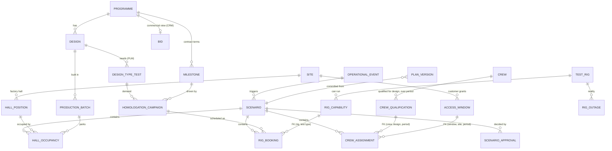

# Part A · Data model

The data model is the product. Everything else (dashboards, scenarios, the agent) is a reader or a proposer on top of it.

## 0. Five rules, in business language

| Code | The rule | Type | Enforced by |
|---|---|---|---|
| **R1** | One campaign per rig, and only on a rig that can run the test | Blocks | `rig_exclusive` (EXCLUDE), FK to `rig_capability` |
| **R2** | Only crews qualified for that vehicle, on those dates | Blocks | Composite FK to `crew_qualification` + `CHECK` |
| **R3** | Crews free (travel included) and inside the customer's window | Blocks | `crew_exclusive` (EXCLUDE), composite FK to `access_window` + `CHECK` |
| **R4** | Hall space is never over-committed | Blocks | `hall_position_exclusive` (EXCLUDE) |
| **R5** | Every plan carries its price: late milestones, penalties, recoverability | Prices, escalates | `v_penalty_exposure` + commit gate G5 |

R1 to R4 make the impossible impossible to save. R5 makes the expensive visible and puts a person on the hook for it. The mapping from business rule to database object is itself a table (`rule_catalog`), so every refusal is reported in business language.

## 1. The core decision: two planes, one model

| Plane | What lives there | Store | Why |
|---|---|---|---|
| **Analytical plane** | Everything ingested, conformed, historised. The portfolio picture. | Delta tables in Unity Catalog (bronze, silver, gold) | Many heterogeneous sources, history, scale, lineage, BI and AI on one copy |
| **Commit plane (plan of record)** | Committed bookings of scarce resources, scenarios, proposals, approvals | Lakebase (managed Postgres), registered in Unity Catalog and replicated to Delta | Hard rules must be **impossible to violate**, not detected later |

Why the split: Delta enforces `NOT NULL` and `CHECK`, both row-local. Primary and foreign keys in Delta are informational. "A rig hosts one campaign at a time" is a cross-row rule over time intervals. Delta cannot make it impossible. Postgres can, with `EXCLUDE` constraints, enforced foreign keys, transactions and row-level security. The ledger is small (thousands of rows, tens of commits per day), so an OLTP store fits.

The commit plane holds **only what needs transactional guarantees**. Everything else stays in the lakehouse.

## 2. Entity map

Four families:

1. **Reference** (programme, design, type tests, sites, milestones, campaigns). Owned by source systems, conformed in silver, synced into the ledger read-only. Soft-retire only so foreign keys always hold.
2. **Scarce resources** (rigs, capabilities, crews, qualifications, access windows, hall positions). Today this knowledge lives in planner trackers and heads. **The ledger becomes its system of record.** This is the biggest organisational change in the design.
3. **Plan** (rig booking, crew assignment, hall occupancy), always scoped by `scenario_id`. `BASELINE` is the committed plan. What-ifs and agent proposals are branches with the same structure.
4. **Reality and governance** (operational events, outages, scenario, approvals, plan versions, guardrail policy).

## 3. Tables, grain and keys

| Table | Grain (one row per...) | Key | Owner / source |
|---|---|---|---|
| `programme` | programme or live bid | `programme_id` (register) | Register + CRM |
| `design` | vehicle configuration | `design_id` | PLM |
| `design_type_test` | type test a design must pass | `(design_id, test_type_id)` | PLM |
| `milestone` | contractual milestone, with penalty rate, cap, recovery link | `milestone_id` | Contract / CRM |
| `homologation_campaign` | test campaign needed for a design | `campaign_id`; FK `(design_id, test_type_id)` | PLM + planners |
| `test_rig`, `rig_capability` | rig; rig x test type it can run | `rig_id`; `(rig_id, test_type_id)` | Planners (trackers today) |
| `crew`, `crew_qualification` | crew; crew x design x validity period | `crew_id`; `(crew_id, design_id, valid_period)` | Planners / HR |
| `access_window` | night or weekend window granted by a customer | `window_id`; unique `(window_id, site_id, period)` | Customer, entered by planners |
| `hall_position` | physical parking bay in a factory hall | `position_id` | Factory |
| `production_batch` | batch of car-bodies moving through steps | `batch_id` | MES (mirrored) |
| `scenario` | committed plan, what-if or agent proposal | `scenario_id`; `base_version` | Ledger |
| `rig_booking` | campaign scheduled on a rig in a scenario | `(scenario_id, booking_key)` | Ledger |
| `crew_assignment` | crew on a commissioning shift in a scenario | `(scenario_id, assignment_key)` | Ledger |
| `hall_occupancy` | batch parked on a position over a period, in a scenario | `(scenario_id, occupancy_key)` | Ledger |
| `operational_event`, `rig_outage` | something that happened in reality | `event_id`, `outage_id` | Sources + planners |
| `scenario_approval` | one human decision on a scenario | `(scenario_id, approver)` | Ledger |
| `plan_version` | one commit of the plan of record | `version` | Ledger |
| `guardrail_policy` | business thresholds for "ruinous" | singleton | Business owner |
| `rule_catalog` | constraint or gate, mapped to R1 to R5 | `enforced_by` | Ledger |
| `rejection_log` | one refused write, with actor, rule and resource | `rejection_id` | Ledger |

Time is always a half-open interval `[start, end)` (`tstzrange`). This makes overlap a single operator (`&&`) and containment another (`<@`).

`booking_key` stays stable across scenarios. That is what lets the app show "this booking moved from RIG-A to RIG-B" as a diff.

## 4. How the hard rules actually hold

The test for every rule: **can a write that breaks it ever reach the committed plan?** Each mechanism below is enforced by the database for every writer, including the table owner, planners and the agent. Proven in [`sql/03_seed_and_tests.sql`](sql/03_seed_and_tests.sql), output in [`sql/test_output.txt`](sql/test_output.txt).

| Rule | Mechanism | Type | Test |
|---|---|---|---|
| A rig hosts one campaign at a time | `EXCLUDE USING gist (scenario_id =, rig_id =, period &&)` | Hard, structural | B1, A2, P1 |
| The rig can run that test | FK `(rig_id, test_type_id)` to `rig_capability` | Hard, structural | A1 |
| We only plan tests the design needs | FK `(design_id, test_type_id)` to `design_type_test` via campaign | Hard, structural | schema |
| Each campaign booked once per plan | `UNIQUE (scenario_id, campaign_id)` | Hard, structural | B2 |
| Crew qualified for the vehicle, on those dates | Composite FK `(crew_id, design_id, qual_period)` to `crew_qualification` + `CHECK (period <@ qual_period)` | Hard, structural | A3 |
| Crew works inside the customer's access window | Composite FK `(window_id, site_id, window_period)` to `access_window` + `CHECK (period <@ window_period)` | Hard, structural | A4 |
| Crew in one place at a time, travel included | `EXCLUDE (scenario_id =, crew_id =, [mobilise_from, end) &&)` | Hard, structural | A5 |
| Hall space never over-committed | Hall discretised into positions; `EXCLUDE (scenario_id =, position_id =, period &&)` | Hard, structural | A6 |
| Nothing committed on a broken rig or revoked window | Commit gate G4 over `v_plan_conflicts` | Hard, re-validated at commit | P4 |
| Milestone dates and penalties | Not a constraint. Priced per scenario in `v_penalty_exposure` (rate, cap, recoverable-by link). Gate G5 escalates above threshold | Soft, priced and escalated | P2 |
| Only humans commit; only via one path | Grants, RLS, `commit_scenario()` is the only writer of `BASELINE` | Governance | A7, A8, A9 |
| No overwriting a newer plan | `base_version` check under row lock on `plan_head` (optimistic concurrency) | Governance | P3 |

Three design moves worth defending:

1. **Denormalise through a composite FK, then check row-locally.** The assignment carries the window period and qualification period, guaranteed correct by the foreign key. Containment becomes a plain `CHECK`. No triggers, no race conditions.
2. **Turn capacity (a sum) into exclusivity (a uniqueness).** "At most 12 car-bodies in hall H1" becomes "one batch per bay per time". It mirrors the physical reality (bays have length, crane access) and lets Postgres enforce it natively. If bays turn out to be fully interchangeable, the app auto-assigns the first free bay, and the rule still holds.
3. **Scope every constraint by `scenario_id`.** Every what-if and every agent proposal is feasible by construction, not only the committed plan. A scenario that cannot exist cannot be shown to a planner.

## 5. Reality versus plan

Reality can break a committed plan. A rig fails, a customer revokes a window. The design never blocks reality from being recorded:

- Events land in `operational_event` and facts in `rig_outage` / `access_window.status`.
- `v_plan_conflicts` shows where the committed plan no longer matches reality. This view is the **trigger** for the agent and a red flag on the portfolio picture.
- The same view is gate **G4** at commit: a new plan cannot be committed while it conflicts with known reality.

Rule of thumb: structural truths become constraints; truths that change under a committed plan become a commit gate plus a conflict view.

## 6. Plans, scenarios, versions

- A scenario is a full branch of the committed plan (copy-on-branch). At this scale (25 programmes, a few thousand bookings) a copy costs milliseconds and keeps the constraint model trivial.
- `plan_head.version` increments on every commit. A scenario remembers the version it came from. Commit takes a row lock on `plan_head` and rejects stale scenarios. Two planners cannot silently overwrite each other.
- `plan_version` + replicated history in Delta give a full audit: who committed what, from which proposal, at what penalty delta.

## 7. Refusals are data

Agents and the planner app write through small tools (`try_move_booking`, `try_assign_crew`, `try_park_batch`, `try_commit`). They run as the caller, so RLS and every constraint still apply. When the database refuses a write, the tool rolls it back and logs it in `rejection_log` with the rule that refused it.

That log serves three readers:

- **Audit:** who tried what, when, and which rule stopped it.
- **The agent:** the refusal is its feedback for the next attempt, and its history is evaluation data.
- **The business:** `v_rejection_pressure` shows which scarce resources keep being refused. In the test run, RIG-B is refused four times under R1. Repeated over a quarter, that is the business case for renting rig capacity or adding a crew.

Tested in L1 of [`sql/03_seed_and_tests.sql`](sql/03_seed_and_tests.sql).

## 8. What the model deliberately leaves out of the ledger

- **Shop-floor sequencing** stays in each factory's MES. The ledger owns shared scarce resources and interface dates between factories. Central planning that tries to own every machine slot fails on adoption.
- **Bottleneck lines** (paint, final assembly) attach with the same pattern as the hall: discretise into slots, `EXCLUDE` on slot and time. Named, not built.
- **Cost and cash** live in the lakehouse (`silver.cost_plan_month`, gold margin views). The ledger exposes the penalty delta; margin impact joins in gold.
- **Bids** are programmes with status `BID` and a design shell, so "if this bid lands" uses the same booking tables. Bid probability weighting belongs in gold.

## 9. Assumptions to validate

- Hall space behaves as discrete bays. If it is linear metres or square metres, R4 becomes a sum: inside the commit gate, under the existing lock, check that peak occupied length per day stays under hall capacity. Same gate, different check, same guarantee for the committed plan.
- Mobilisation time is a conservative buffer per assignment. Exact sequence-dependent travel is the optimiser's job; the constraint guarantees the safe minimum.
- One rig runs one campaign at a time, as the brief states. If a rig can host two light tests, model capacity per rig with positions, same as the hall.
- Lakebase supports `btree_gist` (needed for `=` on text inside an exclusion constraint). Verify per region. Fallback: commits are already serialised by the row lock on `plan_head`, so an explicit overlap query inside `commit_scenario()` gives the same guarantee for the committed plan (drafts lose the instant feedback).
