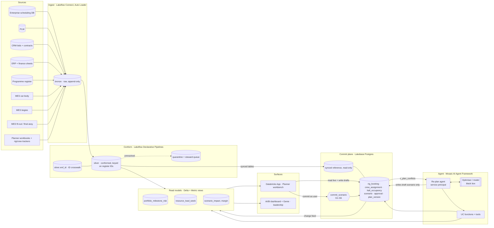

# Part B · Databricks stack design

## 1. End to end

## 2. Layer by layer, and why

| Layer | Choice | Why this, not something else |
|---|---|---|
| Ingest DBs | **Lakeflow Connect** (or JDBC CDC jobs) for scheduling DB, ERP, CRM | Managed CDC, no custom extract code to own |
| Ingest files | **Auto Loader** into bronze from a UC Volume (planner workbooks, MES exports) | Schema drift tolerated, every file traced (`_metadata.file_path`) |
| Conform | **Lakeflow Declarative Pipelines** with expectations; `silver.xref_id` crosswalk; quarantine table | ID resolution is the real work. Expectations make bad rows visible with a count, never silently lost |
| History | `AUTO CDC` (SCD2) on milestones, contract terms, qualifications | "What did we believe on the day we committed?" is an audit question we will get |
| Plan of record | **Lakebase** (managed Postgres) | Only place in the stack that enforces cross-row rules (EXCLUDE), FKs, transactions, RLS. See Part A |
| Reference into ledger | **Synced tables** UC to Lakebase | One source of truth in silver; ledger reads it, never edits it |
| Ledger into lakehouse | Lakebase registered in UC + replication to Delta | Gold, dashboards and agent read one governed copy; full history for audit |
| Read models | Gold materialized views + **metric views** (penalty exposure, utilisation) | One definition of "late" and "exposure" for app, dashboard, Genie and agent |
| Planner surface | **Databricks App** (on-behalf-of-user auth) | Runs inside the workspace, inherits UC identity, talks to Lakebase natively. Commits run as the planner, not as a shared app account |
| Leadership surface | **AI/BI dashboard** + **Genie** space on gold | Live portfolio picture and ad-hoc questions without building a second app |
| Agent | **Mosaic AI Agent Framework**, served on Model Serving, tools as **UC functions**, traces in **MLflow** | Tools are governed objects with grants and lineage. Every proposal is traceable to inputs |
| Optimiser | One box, called by the agent (Model Serving endpoint or a Job) | Out of scope. Context in, structured proposal out |
| Orchestration | **Lakeflow Jobs**, event-triggered on ledger conflicts | Re-plan runs when reality changes, not on a timer |

## 3. Where the operational logic lives

- **Hard rules:** in the ledger schema (constraints). Not in the app, not in the agent, not in a pipeline.
- **Business policy** (what counts as ruinous): in the ledger as data (`guardrail_policy`), applied by the commit gate. Owned by the business, changed without a deploy.
- **Derived risk** (forecasts, exposure, utilisation): views in the ledger for scenario-level answers, gold for portfolio-level answers.
- **Intelligence:** in the black box. It proposes. It never decides.

## 4. Write-back, safely

1. The planner app reads gold for the picture and the ledger for live state (no sync lag on what you are about to change).
2. Every edit lands in a scenario (draft). Constraints reject infeasible edits on the spot with a readable reason.
3. Commit calls `commit_scenario()` as the planner's identity. Six gates, one transaction. Either the whole re-plan lands or nothing does.
4. The new plan version flows to Delta via the change feed and refreshes the portfolio picture.

## 5. Governance: who sees and does what

| Persona | Sees | Does |
|---|---|---|
| Lead / central planner | All programmes, all resources | Create what-ifs, edit any open scenario, commit |
| Factory planner | Own factory rows (UC row filter), shared resources read-only | Propose interface-date changes |
| Programme director | Own programmes incl. margin (column mask) | Approve escalated scenarios (G5) |
| Finance | Margin, cash, penalty exposure | Read |
| Leadership | Portfolio picture, Genie | Read |
| Re-plan agent (service principal) | Gold + ledger, no margin detail it does not need | Branch and edit **its own draft**, submit. Nothing else |

Grants in Unity Catalog, RLS and function grants in Lakebase. Same identities on both sides.

## 6. Where this strains at portfolio scale

- **Scenario fan-out.** Copy-on-branch is fine for tens of scenarios. Monte Carlo over hundreds of bid combinations does not belong in the ledger: run those in the lakehouse (Spark, Delta) and promote only the candidate worth committing into Lakebase.
- **Single commit lock.** One `plan_head` lock serialises commits. Fine at tens of commits per day. At higher rates, partition the lock per resource pool (rigs, crews per region, halls per factory).
- **Five-year horizon.** Bookings years out are low-confidence. Keep them as ranges or soft holds rather than precise dates, or the plan becomes false precision that triggers needless re-plans.

## 7. Failure modes

1. **Shadow planning.** Planners keep the Excel workbook as the real plan and update the ledger later. The constraints then guard a fiction. Mitigation: retire the trackers explicitly, export-only Excel views, adoption measured as "% of plan changes committed through the ledger".
2. **Silent ID drift.** A factory renames batch codes; rows fail to resolve, demand disappears from the picture, the plan looks healthier than reality. Mitigation: quarantine, unresolved-rate KPI on the dashboard, steward queue with an owner.
3. **Sync lag read as truth.** Gold refreshes after the ledger. An agent reading gold might propose against a plan that just changed. Mitigation: agent reads live ledger for the resources it touches, and G2 rejects stale proposals anyway.
