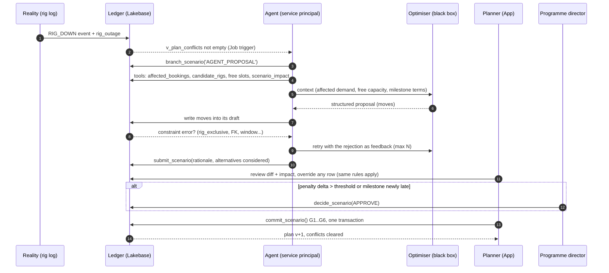

# Part C · The re-plan agent

Principle: **the agent proposes, the data model disposes, a human decides.** Safety does not depend on the model behaving well. It depends on what the agent's identity is physically allowed to write.

## 1. First cut: one trigger, one action

| | First cut | Why |
|---|---|---|
| Trigger | **Test rig goes down** (`RIG_DOWN` event creates conflicts in `v_plan_conflicts`) | Scarcest resource, clearest blast radius (campaigns, then type-approval milestones), months of impact, today handled by one or two people |
| Action it proposes | **Re-sequence homologation campaigns across capable rigs** (move rig and dates of affected `rig_booking` rows) | Bounded search space, fully covered by hard rules already in the model |
| Second (next) | **Bid lands**: place the new programme's campaigns and commissioning crews | Same tables, adds crew moves |
| Third | Milestone slip, window revoked | Same mechanics, more crew logic |

## 2. What it never touches

- Contract milestone dates and penalty terms (no grant).
- Customer access windows, rig capabilities, crew qualifications (reference and resource master data, no grant).
- Factory shop-floor sequencing (not in the ledger at all).
- The committed plan (`BASELINE`), approvals, policy thresholds (RLS + no function grant).
- Bid pricing and customer communication. It can show the consequence; humans negotiate.

## 3. The loop

## 4. What it reads, and how

Read through **UC functions as tools**, each a governed object with grants, lineage and a test:

- `affected_bookings(event_id)`: bookings in conflict with the event.
- `candidate_rigs(test_type)`: rigs able to run the test.
- `rig_free_slots(rig_id, from, to)`: gaps in the live ledger.
- `qualified_crews(design_id, window_id)`: for the bid and commissioning cases.
- `scenario_impact(scenario_id)`: penalty delta, newly late milestones, unscheduled demand.

It reads the **live ledger** for the resources it moves (no sync lag), and gold for context (portfolio risk, other programmes' exposure).

## 5. How it writes

The agent never writes raw SQL. Its whole action catalogue is four tools:

| Tool | What it does | Who can call it |
|---|---|---|
| `branch_scenario` | Open its own draft from the committed plan | agent, planner |
| `try_move_booking` | Move a campaign to a rig and period | agent, planner |
| `try_assign_crew` | Place a crew in a customer window (looks up qualification and window) | agent, planner |
| `submit_scenario` | Hand the draft to a planner with its rationale | agent, planner |

Each tool returns `OK` or `REJECTED <rule> <constraint>`. A refusal is feedback for the next attempt and is kept in `rejection_log`. Over time that log is the agent's evaluation set: what it proposed, what the database refused, what planners approved, edited or rejected.

## 6. Guardrails, and where they actually live

| # | Guardrail | Lives in | Fails how |
|---|---|---|---|
| 1 | Agent can only write its own draft scenario | Lakebase grants + RLS | `row-level security` error |
| 2 | Every row it writes is feasible (rig, crew, window, hall) | Ledger constraints | Constraint error returned to the agent as feedback |
| 3 | Cannot change contract terms or resource master data | Grants | `permission denied` |
| 4 | Cannot commit | No EXECUTE on `commit_scenario` | `permission denied` |
| 5 | No commit against known reality conflicts | Gate G4 | Commit rejected |
| 6 | Stale proposals cannot overwrite newer plans | Gate G2 (version check) | Commit rejected, scenario marked STALE |
| 7 | "Ruinous" plans need a director | Gate G5 + `guardrail_policy` (business-owned data) | Commit rejected until approval |
| 8 | No self-approval, human of record on every commit | `decide_scenario`, `plan_version.committed_by` | Rejected |
| 9 | Every proposal explainable | MLflow trace + `scenario.rationale` + row-level diff with `last_modified_by` | Audit |
| 10 | Every refusal kept | `rejection_log` via the write tools | Feedback, evaluation, demand signal |

Guardrails 1 to 8 are enforced by the database for every caller. A prompt injection, a model bug or a wrong tool call cannot bypass them. Guardrail 9 is the quality loop.

All of this is exercised in [`sql/03_seed_and_tests.sql`](sql/03_seed_and_tests.sql): tests A1 to A9 (agent), P1 to P4 (planner and commit gate), L1 (rejection log).

## 7. Approve, override, edit

The planner sees, per proposal:

- The trigger (what happened) and the agent's rationale.
- A diff per booking: old rig and dates, new rig and dates.
- Impact: penalty delta, milestones newly late, resources now at 100%.
- Actions: **Approve and commit**, **Edit** (drag a booking; same constraints reject invalid moves instantly), **Reject** with a reason (feeds evaluation).

In the test run, the agent's proposal cost EUR 2.95M (type approval 59 days late). The planner pulled another campaign forward on the alternate rig and cut it to EUR 1.4M, then a director approved. The data model held both of them to the same rules. That is the design working: the agent does the search, the planner adds what only they know.

## 8. Measuring it

- Time from event to committed re-plan (target: same day, from days today).
- Acceptance rate: approved as-is / edited / rejected, with reasons.
- Penalty delta of agent proposal versus the committed plan (how much the planner had to improve it).
- Constraint rejections per proposal, by rule (how often the black box tries infeasible moves, and which rule it misunderstands).

## 9. In the first cut versus later

| First cut | Later |
|---|---|
| Rig-down re-plan, homologation campaigns only | Bid lands, crew re-assignment, window revoked |
| One proposal plus the top alternative | Several ranked options with trade-offs |
| Penalty delta as the economic signal | Full margin and cash impact from gold |
| Human commits everything | Auto-commit for zero-impact moves (no milestone change, no penalty delta), once acceptance data justifies it |
| Agent triggered by conflicts | Agent watches early warnings (rig utilisation, slippage trends) and proposes before conflicts happen |
