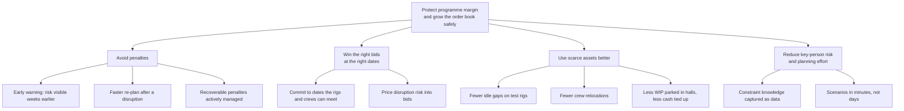

# Business value analysis

## 1. The problem in business terms

Ferronova sells long, fixed-date, penalty-backed programmes on thin margins, and plans them in spreadsheets held by a few people.

- **Thin margins, hard penalties.** Rolling-stock makers typically run single-digit operating margins. Late-delivery penalties are commonly capped around 5 to 10% of contract value. One slipped milestone can erase a programme's profit.
- **Shared scarce resources.** A handful of test rigs and crews serve 20 to 25 programmes. A problem on one programme moves risk onto others, and nobody sees it until a milestone is already late.
- **Decisions without consequences visible.** Today nobody can answer "if this bid lands, or this rig goes down, what happens to everything else and to our margin?" in less than days.
- **Key-person risk.** The real constraint knowledge sits with a few senior planners. If one leaves, the company loses its ability to plan.

## 2. Value tree

## 3. Sizing (order of magnitude, to validate in week 1)

All inputs are assumptions. The point is the shape and the sensitivity, not the decimal.

| Input | Assumption |
|---|---|
| Programmes in flight | 22, average contract value EUR 350M, so about EUR 7.7bn in flight |
| Revenue per year | about EUR 2.5bn (programmes run about 3 years) |
| Operating margin | 6%, so about EUR 150M per year |
| Penalties actually paid or accrued | 1% of revenue, about EUR 25M per year |
| Major disruptions (rig down, crew gap, bid landing) | 4 to 6 per year with milestone impact |

| Lever | Logic | Annual value |
|---|---|---|
| **Penalty avoidance** | 20 to 40% fewer penalties through earlier detection and same-day re-plans | **EUR 5 to 10M** |
| **Disruption recovery** | 2 weeks recovered per major disruption at EUR 40 to 60k per day of penalty exposure | EUR 2 to 4M (overlaps partly with the line above) |
| **Bid risk avoided** | One bid per year committed to dates the rigs cannot meet. Penalty cap on a EUR 700M bid at 10% is EUR 70M of tail exposure | Risk avoidance, not P&L. The strongest argument for leadership |
| **Asset use** | Fewer idle rig gaps, fewer crew moves, less WIP in halls | EUR 0.5 to 2M plus working capital |
| **Planner capacity** | Scenario analysis from days to minutes; planners spend time deciding instead of reconciling | Capacity, resilience, retention |

Reading: the hard-number case is penalties, about **3 to 7% of annual operating profit**. The board-level case is **bid risk and resilience**. A rough build of EUR 1 to 1.5M (team of 4 to 5 for 6 to 9 months, plus platform run cost) pays back within a year if the penalty assumption holds.

Sensitivity that matters: if realised penalties are 0.3% of revenue instead of 1%, the penalty lever drops to EUR 1.5 to 3M and the case rests on bid risk and resilience. That is the first number to get from finance.

## 4. The order to unlock it

Value grows with each step, and each step is the foundation of the next. The agent is the last step, not the first.

| Phase | What ships | Value unlocked | Typical timing |
|---|---|---|---|
| **1. One picture** | Ingest, ID crosswalk, conformed model, portfolio risk dashboard. Read-only | Leadership sees where risk builds. Data quality becomes visible and owned | Weeks 0 to 8 |
| **2. Plan of record for scarce resources** | Rig, crew and hall ledger with hard rules. Planners commit through the app. Trackers retired | No more double bookings. One truth for scarce assets. Constraint knowledge captured | Weeks 6 to 16 |
| **3. What-if** | Scenarios for bids and disruptions with penalty exposure | Bid decisions on real capacity. Faster response to disruption | Weeks 12 to 20 |
| **4. Agent proposes** | Rig-down re-plan agent, human approval | Re-plan time from days to hours. Planner focus on judgment | Weeks 18 to 26 |
| Later | Margin and cash forecast, portfolio optimisation, factory line balancing | Attach to the same model | After |

**Push-back for the client:** the ask is "an agent on top". An agent on today's data would reason over spreadsheets that disagree with each other. Phases 1 and 2 deliver most of the risk reduction on their own and make the agent safe. We sell the agent as the payoff of a governed model, not as the starting point.

## 5. How we will know it works

| KPI | Baseline to capture | Target direction |
|---|---|---|
| Penalties paid or accrued per year | Last 3 years from finance | Down |
| Lead time from risk visible to milestone date | Today, often days before the date | Weeks earlier |
| Time from disruption to committed re-plan | Today, days | Same day |
| % of plan changes committed through the ledger | 0% | Above 90% (adoption) |
| Unresolved source records | Unknown today | Below 1%, owned by stewards |
| Rig utilisation and idle gaps | From trackers | Up, fewer gaps |
| Agent proposals approved as-is or with edits | n/a | Rising over time |

## 6. What makes or breaks it

1. **Planner adoption.** The senior planners must see their own knowledge in the model and keep the final say. Co-design the rules with them, show the constraint rejecting a move they would also reject, and never let the tool commit for them. If they keep Excel as the real plan, the system guards a fiction.
2. **One write path.** The plan of record is only valuable if every change to rigs, crews and halls goes through it. That is a management decision (retire the trackers), not a technical one.
3. **Data conformance and ownership.** Each factory names things differently. Without a crosswalk with named stewards, demand silently disappears from the picture, and the dashboard looks healthier than reality.

## 7. Open questions

**Business**

- What did penalties cost in the last 3 years, and which milestones caused them? (Sizes the case.)
- Which is the real binding constraint today: rigs, crews or hall space?
- How are penalties written: caps, recoverability, force majeure for rig failure?
- Who has authority to accept a plan that makes a customer milestone late?
- At what bid probability should a bid reserve rig or crew capacity?
- How will factories react to central visibility of their schedules?
- What autonomy is acceptable for the agent in year one? (Our default: none without a human.)

**Technical**

- Can we read the scheduling DB directly, with change capture, or only via exports?
- Which MES tools per factory, and what can each export, how often?
- How complete is the programme register for batches, rigs and crews (not only programmes and vehicles)?
- Is Lakebase available in the client's region and cloud, with the `btree_gist` extension?
- Identity: are planners, directors and factories already in Entra ID groups we can map to Unity Catalog?
- How fresh must the portfolio picture be: minutes, hours, daily?
- How many scenarios do planners run at once, and do they need Monte Carlo over bids?
